<div align="center">

# peaks-loop

### You talk. It runs the entire engineering chain for you — beyond just code, twice-run flows sediment into local tactics.

[](https://www.npmjs.com/package/peaks-loop)
[](https://github.com/SquabbyZ/peaks-loop/actions/workflows/publish.yml)
[](https://github.com/SquabbyZ/peaks-loop/actions/workflows/ci.yml)
[](./LICENSE)
[](https://www.npmjs.com/package/peaks-loop)
[](https://github.com/SquabbyZ/peaks-loop/stargazers)

**English** · [简体中文](./README.md)

</div>

<p align="center">
  
</p>

---

## What it is

peaks-loop is an orchestration layer that sits on the AI coding tool you already use (**Claude Code** / **Z Code**). You send one slash command in the chat box and it runs the whole chain for you: split the work → run it gate by gate → **stop at the gate that breaks**.

There are only two things you ever do: **say a sentence**, or **pick one option**.

- **It is not a new AI CLI.** It does not grab your shell, your prompt, or your IDE, and it does not replace any native entry point inside them.
- **You memorize no CLI, hand-author no manifest, hand-fill no form.** All CLI verbs are hidden from you and open to the LLM; it runs the commands, you just talk.
- **It does not decide for you.** Decisions that touch your assets come back to you as a choice; everything else it runs on its own.

---

## Up and running in 30 seconds

```bash
npm i -g peaks-loop
```

> **On npm 11+, pass one flag.** npm prints an `install-scripts` warning for lifecycle scripts that are not
> covered by its allowlist. **At the current version (npm 11.19) the scripts still run**, so the install works
> as-is — but npm says that default is about to flip. To avoid silently ending up with "a CLI, no skills", write
> it out fully:
>
> ```bash
> npm i -g --allow-scripts=peaks-loop peaks-loop
> ```
>
> If you suspect the skills did not land, **no CLI command reports that state today**
> (`peaks skill search` queries the in-package skill pool, which says nothing about your IDE directory), so
> look at the directory itself:
>
> ```bash
> ls ~/.claude/skills | grep '^peaks-' | head    # or the IDE dir you actually use
> ```
>
> Empty means the CLI installed but the skills did not. The gap is recorded in `.peaks/docs/backlog.md` §2.52a.

Then, in the **Claude Code** or **Z Code** chat you already use, send an **explicit slash command** (the leading slash is what triggers peaks-loop):

```
/peaks-code walk me through this codebase
```

The rest is peaks-loop's job — it picks the domain from the slash, routes to the right orchestrator, splits the work gate by gate, **stops where it breaks**, never hands you a half-finished slice.

Other slash commands you'll reach for:

```
/peaks-content                 draft and publish today's post
/peaks-doctor                  run a health check on this repo
/peaks-issue-fix-orchestrator  fix the next 30 open issues upstream
/peaks-sop                     author the team's release SOP
/peaks-solo                    I'll do this again — sediment it as a local tactic
```

<sub>📦 Adapters for other AI coding tools are coming — contributions welcome → [GitHub Issues](https://github.com/SquabbyZ/peaks-loop/issues).</sub>

No CLI to memorize. No manifest to hand-author. No second terminal to open. **Send the slash, the rest is on it.**

> **How much more does this download?** This version ships the mutation-testing engine
> (`@stryker-mutator/core` + `@stryker-mutator/vitest-runner`) as a **runtime dependency**, so the install
> pulls the stryker engine closure — **about 2.66 MB (9 packages)** more. The vitest family's 5.30 MB is only
> auto-installed **if your machine does not have vitest yet**, and any project that runs `peaks mut` already
> has vitest. **In one line: installing peaks-loop downloads about 2.7 MB more.**

---

## Where files land after install

After `npm i -g`, the three asset classes (**skills / agents / output-styles**) are stored **once**, under
`~/.peaks/{skills,agents,output-styles}` in your own home directory. Every entry in each IDE directory
(`~/.claude/…`, `~/.trae/…`, and so on) is **a link to it** — directories via junction, individual `.md` files
via symlink. So upgrading `peaks-loop` leaves the link targets unchanged and needs no rebuild.

Two things that affect you directly:

- **Managed entries are overwritten on upgrade.** An entry peaks-loop installed (say
  `~/.claude/agents/karpathy-reviewer.md`) sits next to a `.peaks-managed` sidecar that marks ownership, and its
  contents are updated on upgrade. **To keep your own version instead, delete that sidecar** — an entry without
  the marker is always treated as yours, and is **never replaced and never deleted**.
- **On some Windows hosts they degrade to real copies.** Without Developer Mode and without administrator
  rights, **file** symlinks cannot be created (the junctions used for directories are unaffected), so the
  installer writes real copies and says so on stderr: `installed as REAL COPIES because this host refused a symlink`.
  The contents still follow the upgrade.

The true-source root can be redirected with the `PEAKS_HOME` environment variable. The full model, what happens
when you upgrade from 4.1.1, and how to verify and roll back →
[`.peaks/docs/canonical-store.md`](./.peaks/docs/canonical-store.md).

---

## What it does for you

Code, content, project health, issue sweeps, custom workflows — **every domain has its own orchestrator**, and each one runs under the same discipline: "gate fails = stop". All you do is pick a command and send it:

| Domain | Send this slash command | It will… |
| --- | --- | --- |
| 💻 **Code (code-domain) only** | `/peaks-code build this feature` | PRD → RD → code → QA → UI → slice, ready for your sign-off |
| 💻 **Code (code-domain) only** | `/peaks-code fix this bug` | reproduce → patch → review → tests, ship same day |
| 📝 **Content** | `/peaks-content draft and publish this post` | draft → edit → tone check → publish → archive, no skipped steps |
| 🩺 **Project health** | `/peaks-doctor run a health check on this repo` | red-line audit + L3 doctor + convert to OpenSpec, stops where it breaks |
| 🐛 **Issue sweep** | `/peaks-issue-fix-orchestrator fix the next 30 open issues upstream` | survey → classify → reference PRs → fix + commit + PR draft |
| 📋 **Custom workflow** | `/peaks-sop author the team's release SOP` | describe in plain language → auto-generate + validate + register |
| 🔁 **Replay** | `/peaks-solo run it like last time` | pull up your sedimented tactic, replay it |
| 🆕 **Onboard** | `/peaks-code this is a new repo, walk me through it` | map structure, flag risks, hand you a learning order |
| 🧠 **Sediment** | `/peaks-solo I'll do this again — save it` | ground it locally as a reusable tactic |
| 🧪 **Open the audit gate** | `/peaks-audit` | 6-dim audit, mandatory entry before RD / QA |
| ✅ **4-dim sign-off** | `/peaks-final-review` | functional / problem / no-new-bugs / no-regression |
| 🔌 **IDE adapter** | `/peaks-ide` | hooks + statusline + handle |
| ⏯ **Resume from a checkpoint** | `/peaks-resume` | scan the deepest finished gate, AskUserQuestion |
| 🔬 **Slice decomposition** | `/peaks-slice-decompose` | multi-pass + cross-pass edges + arbitration |

Every lane opens with **one slash command**.

---

## Why people pick it

- **Natural language is the interface.** No CLI to learn, no commands to memorize. **Use an explicit slash command (e.g. `/peaks-code xxx`)** to route to the right orchestrator; everything after the slash is plain language. The LLM runs the commands on your behalf.
- **Gates that actually block, not decorate.** Code audit, security scan, QA gate, review sign-off — all on by default. **Audit fails = stop. QA fails = stop.**
- **Run-once flows become local tactics (bees).** What sediments lands in your local `~/.peaks/` pool — twice-clean runs auto-promote, broken runs come back for you to redefine. **Next time, just say "run that one" and the whole playbook slots back in.** Your few tactics grow with your taste.
- **Sits on top of what you already run.** Not a new AI CLI to learn — it rides on **Claude Code** and **Z Code**. No shell grab, no prompt grab, no IDE grab. Other tools: adapters in progress.
- **You decide, it executes.** Decisions that touch your assets are yours; everything else it runs on its own. **Zero learning cost. One minute to first task.**

---

## Strongly recommended · compose these three

> **Zero learning cost.** The biggest reason to use them together is that all three speak the same interface — "natural language + one choice". You say one sentence; the LLM runs the commands, applies the gates, and follows the playbook, with nothing for you to memorize.

| Role | Project | One-liner |
| --- | --- | --- |
| **Sediment + gates** | [**peaks-loop**](https://github.com/SquabbyZ/peaks-loop) ← you are here | install → PRD/RD/QA/UI/SC/TXT as one chain + sediment |
| **Tactical handbook** | [affaan-m/ECC](https://github.com/affaan-m/ECC) | the best tactics, skills, and SOPs you can put on top of Claude Code |
| **Process & discipline** | [obra/superpowers](https://github.com/obra/superpowers) | brainstorming / TDD / debugging / code-review as flow disciplines, every one with a hard exit |

**One sentence to use them all**: clone the two repos above, install peaks-loop, hand the rest to your LLM — it pulls what it needs, holds the gates, lands the tactics, sediments the flow.

---

## FAQ

<details>
<summary><b>How does it relate to Claude Code / Z Code?</b></summary>

It **sits on top of** them, not in place of. It doesn't grab your shell, your prompt, or your IDE — you keep using them as usual. **Adapters for other AI coding tools are in progress — contributions welcome** → [GitHub Issues](https://github.com/SquabbyZ/peaks-loop/issues).

</details>

<details>
<summary><b>Do sedimented tactics stay on my machine?</b></summary>

Yes. Sediment lands in a local pool, scoped to you alone. Naming, reuse, iteration — your call. Flows that broke get sent back for you to redefine.

</details>

<details>
<summary><b>Will it change my code without me knowing?</b></summary>

It changes, but **the gates hold**. Audit fails = nothing ships. QA fails = nothing ships. Review fails = nothing ships. It runs; each gate stops for your eyes.

</details>

<details>
<summary><b>What's new in 4.x vs 3.x?</b></summary>

**From a code-only tool to multi-domain orchestration:** it ships four new domain chains — `peaks-content` (content production), `peaks-doctor` (project health), `peaks-issue-fix-orchestrator` (batch issue fix), `peaks-sop` (custom SOPs) — plus `peaks-solo`, a dispatcher that routes from plain language to the right domain. Full list → [`CHANGELOG.md`](./CHANGELOG.md).

</details>

---

## Links

- All skills → [`skills/`](./skills/)
- Changelog → [`CHANGELOG.md`](./CHANGELOG.md)
- Questions → [GitHub Issues](https://github.com/SquabbyZ/peaks-loop/issues)
- Recommended combo: [affaan-m/ECC](https://github.com/affaan-m/ECC) · [obra/superpowers](https://github.com/obra/superpowers)

---

<div align="center">

MIT License · Made by [SquabbyZ](https://github.com/SquabbyZ) · English · [简体中文](./README.md)

</div>
